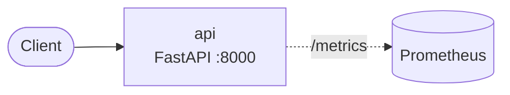

# Architecture

> Keep this page current: update it in the same pull request that changes the architecture.
> The target design is in [scope.md](scope.md). This page describes what is **built** today.

## Context

Mimamori indexes many camera streams so they can be searched, and watched for alerts, in plain words. It never
identifies people. It is part 5 of AI on EKS: a custom operator, shared GPU model serving, and a system run
by SLOs.

## Built so far

| Component | Responsibility | Tech | Status |
|---|---|---|---|
| `api` | HTTP API, runtime contract | Python 3.13, FastAPI, uvicorn | Plumbing done; the demo cameras and choosing the models next |

Planned components are in the [roadmap](roadmap.md).

## Runtime contract (every service)

| Concern | How |
|---|---|
| Liveness | `GET /healthz`: process is up; never checks dependencies |
| Readiness | `GET /readyz`: 503 until started and during shutdown |
| Metrics | `GET /metrics`: Prometheus `http_requests_total`, `http_request_duration_seconds` |
| Logs | One JSON line per event on stdout, with `request_id` |
| Shutdown | On SIGTERM: fail readiness, drain in-flight requests (≤ 20 s), exit 0 |
| Config | Environment variables only; secrets from the platform's secret manager |
| Security | Non-root user, read-only filesystem, no capabilities, minimal base image |

## Data

Planned: frame detections and embeddings in PostgreSQL with pgvector (Amazon RDS), short clips in S3, both
kept 7 days; faces are blurred before anything is stored. See [scope.md](scope.md).

## Deployment

Planned: Terraform for AWS; Argo CD syncs the operator, model server and app from `main`. Cameras are
`Camera` resources in git too. Roll back by reverting the commit.

## Reliability

SLOs are written in phase 2 of the [roadmap](roadmap.md), each with an alert and the runbook it links to.

## Security

Trust boundaries and controls: see [threat-model.md](threat-model.md).

## Decisions

See [adr/](adr/).
