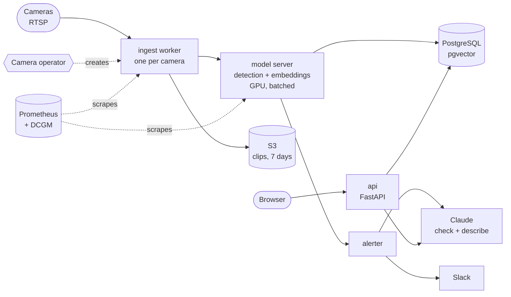

# Scope

Mimamori (見守り, "watching over") lets you search camera footage in plain words and set alerts the same way: "a red
car at the gate", "someone leaves a bag behind". It is the last part of AI on EKS: extending Kubernetes with an
operator, serving models efficiently, and running the whole system by SLOs.

- **It is** a video search and alert system for many camera streams. It finds objects and actions, and describes
  them.
- **It is not** a system for identifying people. No face recognition, no tracking of named individuals. Faces are
  blurred in everything it stores.

## Why security and retail

Most camera footage is never watched. People look only after something has happened, and then they scrub through
hours of video. Searching in plain words, and getting alerts described in words, is a change anyone running a
shop, warehouse or building understands. Many cameras, constant video and shared GPUs also make it the hardest
platform problem in the series.

## The product

| Actor | Does |
|---|---|
| Operator | Watches the camera wall, searches, sets alerts, confirms or dismisses them |
| Admin | Adds cameras with `kubectl apply` |

1. **Cameras:** demo footage replayed as live RTSP streams by MediaMTX, or real cameras you own.
2. **Ingest:** one worker per camera samples about two frames a second, skips frames with no motion, blurs faces,
   and sends frames to the model server.
3. **Index:** the model server detects objects and makes an embedding for each frame; both go into PostgreSQL with
   pgvector, and short clips go to S3.
4. **Search:** type a description. Its embedding finds the nearest frames, and Claude checks the top matches against
   the description and writes one line about each.
5. **Alerts:** standing searches in plain words, checked as frames arrive. A match goes to Slack with the clip, the
   description and a confidence.
6. **Add a camera:** `kubectl apply -f camera.yaml`. The operator creates its worker, and the camera joins the wall.

```yaml
apiVersion: mimamori.codewithmuh.com/v1
kind: Camera
metadata:
  name: front-gate
spec:
  url: rtsp://mediamtx:8554/front-gate
  credentialsSecret: front-gate-rtsp
  fps: 2
  retentionDays: 7
```

**API (v1):** `GET /v1/cameras`, `GET /v1/cameras/{name}/live`, `POST /v1/search`, `POST /v1/alerts`,
`GET /v1/events`, `GET /v1/clips/{id}`.

## Rules

| # | Rule | Enforced by |
|---|---|---|
| R1 | Objects and actions only, never identities. | No face-recognition model in the system; faces blurred before any frame or clip is stored |
| R2 | Only footage you may use. | The demo uses public datasets whose licenses allow it (listed in an ADR), or your own cameras with signage |
| R3 | Footage is kept 7 days. | S3 lifecycle rule and a database clean-up job |
| R4 | An alert always shows its evidence. | Every alert carries the clip, the description and a confidence; a person confirms or dismisses it |
| R5 | Losing the GPU loses no footage. | Ingest buffers frames and catches up; measured in a drill |

## Architecture (target)



## What it teaches on Kubernetes

New in part 5:

- A `Camera` CustomResourceDefinition and an operator in Python (kopf) that turns each camera into a Deployment,
  ConfigMap and Secret
- Model serving with dynamic batching, so many cameras share one GPU (Triton Inference Server or an alternative;
  ADR)
- GPU metrics with the DCGM exporter, and autoscaling the model server on GPU load (KEDA with Prometheus)
- Observability as code: Prometheus, Grafana dashboards, SLOs with burn-rate alerts linked to runbooks
- Capacity planning: how many cameras one GPU serves, and what each camera costs

Reused from earlier parts: Karpenter GPU NodePools, Argo CD, External Secrets (camera credentials), NetworkPolicies
(only ingest pods reach the cameras), Pod Identity.

## Models and licenses

| Task | Model | Runs on | License note |
|---|---|---|---|
| Detection | Open-vocabulary detector (candidates: YOLO-World, Grounding DINO) | Model server, GPU | Check carefully: some popular detectors are GPL or AGPL |
| Embeddings | Image–text embedding model (candidates: SigLIP, CLIP) | Model server, GPU | Confirm in the ADR |
| Face blur | Open-source face detector | Ingest worker, CPU | Detection only, never recognition |
| Check and describe | Claude (vision) | Claude API | Sees only blurred frames |
| Demo footage | Public datasets or your own recordings | | Licenses listed in an ADR |

## Results to publish

| Number | How it is measured |
|---|---|
| Cameras per GPU | At 2 frames a second, before p95 latency breaks the SLO |
| Alert latency | Event on camera → Slack message, p50 and p95 |
| Search quality | Precision of the top 10 results on a labelled set of queries |
| Cost per camera per hour | From 4 to 32 cameras |
| Footage lost when the GPU node dies | Drill; the target is none |

## Out of scope

Face recognition and person re-identification (never), audio, moving (PTZ) camera control, mobile apps.
